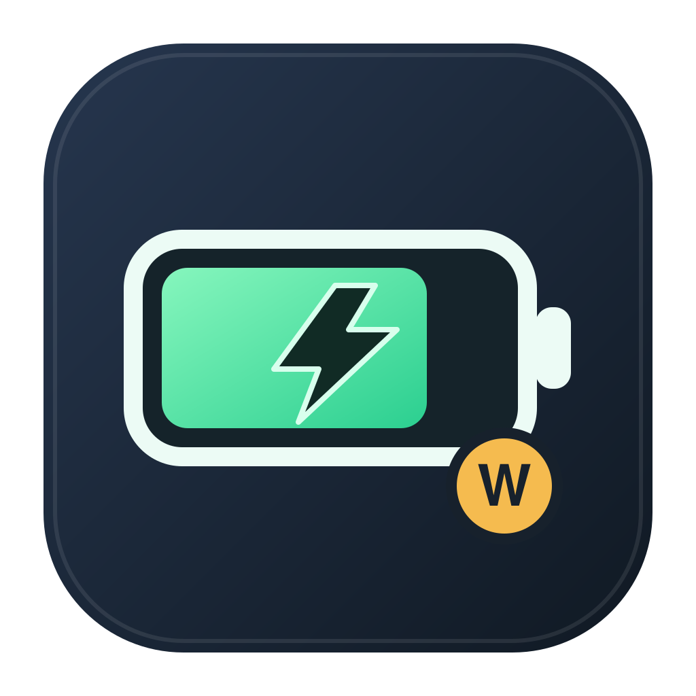

<p align="center">
  
</p>

# 배터리 전력

Mac 메뉴 막대에서 배터리 충전 전력, 잔량, 남은 시간을 보여주는 한국어 앱입니다. [BetterBattery](https://github.com/michaelmax98/BetterBattery)를 바탕으로 만든 **비공식 수정판**이며, 원본 개발자와 별도로 관리합니다.

[최신 버전 다운로드](https://github.com/sabyunrepo/BetterBattery-KR/releases/latest/download/BetterBattery.dmg) · [전체 릴리즈](https://github.com/sabyunrepo/BetterBattery-KR/releases)

## 주요 기능

- 메뉴 막대 배터리 안에 **전력(W) · 잔량(%) · 남은 시간(예: `1h30m`)**을 표시합니다. 원하는 항목만 선택할 수 있고, 여러 개를 선택하면 2초마다 순서대로 바뀝니다.
- 배터리 충전·사용 전력과 잔량 변화의 기록을 볼 수 있습니다.
- 어댑터 출력, 배터리 온도, macOS 기준 최대 용량(배터리 성능), 현재·최대·설계 용량(mAh)을 확인할 수 있습니다. 팬 카드는 기기에서 팬 정보가 감지될 때만 표시됩니다.
- macOS 13 이상에서 동작하며 메뉴 막대에서만 실행됩니다.

## 설치

1. [최신 릴리즈](https://github.com/sabyunrepo/BetterBattery-KR/releases/latest)에서 `BetterBattery.dmg`를 내려받습니다.
2. DMG를 열고 `BetterBattery.app`을 응용 프로그램 폴더로 옮긴 뒤 실행합니다.

현재 공개 빌드는 **Developer ID 서명과 Apple 공증을 거치지 않은 개발용 빌드**입니다. 다른 Mac에서 다운로드하면 macOS의 보안 경고가 표시되거나 실행이 제한될 수 있습니다. 일반 사용자에게 경고 없이 배포하려면 배포자 인증서로 서명하고 공증해야 합니다. 다운로드 무결성은 릴리즈의 `SHA256SUMS.txt`로 확인할 수 있습니다.

## 설정

메뉴 막대의 배터리 아이콘을 눌러 **설정 → 메뉴 막대에 표시**에서 전력·잔량·남은 시간을 각각 켜거나 끌 수 있습니다. 한 항목만 선택하면 고정 표시됩니다. 충전하지 않는 동안 남은 시간은 `대기`로 표시될 수 있습니다.

## 소스에서 빌드

Xcode 또는 Command Line Tools가 설치된 macOS 13 이상이 필요합니다.

```bash
git clone https://github.com/sabyunrepo/BetterBattery-KR.git
cd BetterBattery-KR
VERSION=1.0.0 ./build-app.sh
open build/BetterBattery.app
```

빌드 스크립트가 SVG 아이콘을 생성해 앱에 포함합니다. 앱 번들에는 원본 MIT 라이선스도 포함됩니다. 이 수정판은 원본의 자동 업데이트 기능을 사용하지 않습니다.

## 자동 빌드와 릴리즈

`main`에 코드를 올리면 GitHub Actions가 macOS에서 빌드와 앱 번들을 검사합니다. `v1.0.0` 같은 버전 태그를 올리거나 GitHub Actions의 **Release** 작업에 버전(`1.0.0`)을 입력하면 DMG와 SHA-256 체크섬이 자동으로 릴리즈에 게시됩니다.

## 원본과 라이선스

원본: [michaelmax98/BetterBattery](https://github.com/michaelmax98/BetterBattery) — Copyright © 2026 Michael Maxwell. 본 저장소는 원본을 한국어로 바꾸고 메뉴 막대 표시, 배터리 상세 정보, 아이콘과 UI를 수정했습니다. 원본 소스 및 수정판의 사용·재배포 조건은 [MIT 라이선스](LICENSE)를 확인하세요.
